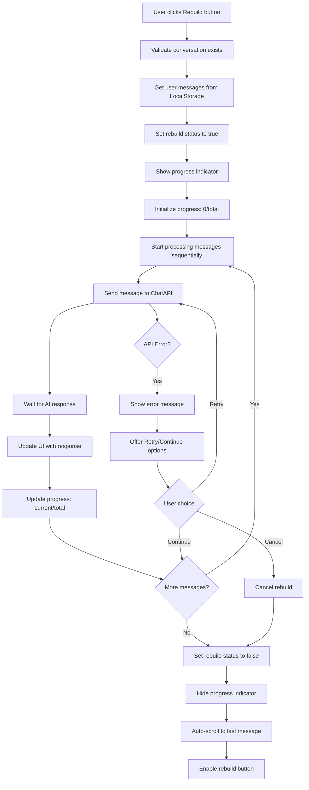

# Rebuild Feature Implementation Documentation

## Overview

The Rebuild feature allows users to save, edit, and rebuild conversations by storing user messages in LocalStorage and re-sending them to generate new AI responses.

## Architecture Changes

### New Services Created

#### 1. UserMessagesService (`src/app/modules/chat/services/user-messages.service.ts`)
- **Purpose**: Manages user messages in LocalStorage
- **Key Methods**:
  - `loadUserMessages()`: Load messages from LocalStorage
  - `saveUserMessages()`: Save messages to LocalStorage
  - `addUserMessage(content, conversationId)`: Add new user message
  - `updateUserMessage(id, content)`: Update existing message
  - `deleteUserMessage(id)`: Delete message
  - `getUserMessagesForConversation(conversationId)`: Get messages for specific conversation
  - `clearUserMessages()`: Clear all messages
  - `setRebuildProgress(progress)`: Update rebuild progress
  - `getRebuildProgress()`: Get current rebuild progress

#### 2. RebuildService (`src/app/modules/chat/services/rebuild.service.ts`)
- **Purpose**: Handles conversation rebuilding logic
- **Key Methods**:
  - `rebuildConversation(options)`: Start rebuild process
  - `getIsRebuilding()`: Get rebuild status
  - `cancelRebuild()`: Cancel ongoing rebuild
  - `getRebuildResult()`: Get rebuild results
  - `clearRebuildResult()`: Clear results
  - `getRebuildStatistics(conversationId)`: Get rebuild stats

### Modified Components

#### 1. ChatComponent (`src/app/modules/chat/components/chat/chat.component.ts`)
- **Changes**:
  - Injected `UserMessagesService` and `RebuildService`
  - Updated `handleSendMessage()` to store user messages in LocalStorage
  - Added `handleMessageEdit()` for message editing
  - Added `handleRebuildConversation()` for rebuild functionality
  - Added helper methods for rebuild status and progress

#### 2. ChatSidebarComponent (`src/app/modules/chat/components/chat-sidebar/sidebar.component.ts`)
- **Changes**:
  - Added rebuild options (preserveIntent, aggressiveness)
  - Added rebuild button with dynamic states
  - Added progress indication
  - Added event emitters for rebuild requests
  - Integrated with rebuild services

#### 3. MessageComponent (`src/app/modules/chat/components/message/message.component.ts`)
- **Changes**:
  - Updated `applyEdit()` to use `UserMessagesService`
  - Added `messageEdited` output event
  - Removed direct conversation rebuilding (now handled by parent)
  - Improved edit validation

## LocalStorage Structure

### Key: `userMessages`
```typescript
interface UserMessage {
  id: string;              // Unique identifier
  content: string;         // Message content
  conversationId: string;  // Associated conversation ID
  timestamp: number;       // Creation timestamp
  lastModified: number;    // Last modification timestamp
}

type UserMessages = UserMessage[];
```

### Key: `rebuildProgress`
```typescript
interface RebuildProgress {
  current: number;    // Current message being processed
  total: number;      // Total messages to process
  conversationId: string; // Active conversation ID
}
```

## Rebuild Workflow

### Step-by-Step Process



### Error Handling

1. **API Errors**: Show error message with retry/continue options
2. **Network Errors**: Pause rebuild, allow retry when connection restored
3. **LocalStorage Errors**: Fallback to session storage or memory
4. **Validation Errors**: Show user-friendly error messages

## UI/UX Features

### Rebuild Button States

1. **Enabled**: `"Apply Optimization to Entire Thread"`
2. **Rebuilding**: `"Rebuilding X/Y"` with spinner
3. **Disabled**: When no conversation or no user messages
4. **Cancel**: `"Cancel Rebuild"` during rebuild process

### Progress Indication

- **Text**: "Rebuilding conversation... X/Y"
- **Progress Bar**: Visual progress indicator
- **Real-time Updates**: Progress updates as each message is processed

### Responsive Design

- Works in both Light and Dark modes
- Mobile-friendly interface
- Proper loading states and animations

## Test Cases and Acceptance Criteria

### Test Case 1: Message Storage
**Scenario**: User sends messages and they are stored in LocalStorage
- **Given**: User is in a conversation
- **When**: User sends a message
- **Then**: Message is stored in LocalStorage with correct structure
- **Acceptance**: LocalStorage contains message with id, content, conversationId, timestamp

### Test Case 2: Message Editing
**Scenario**: User edits a message and changes are persisted
- **Given**: User has sent messages
- **When**: User edits a message and confirms
- **Then**: LocalStorage is updated with new content
- **Acceptance**: Original message content is replaced, lastModified timestamp updated

### Test Case 3: Rebuild Process
**Scenario**: User rebuilds conversation successfully
- **Given**: User has multiple messages in conversation
- **When**: User clicks rebuild button
- **Then**: All user messages are re-sent sequentially, AI responses generated
- **Acceptance**: UI shows progress, new responses appear, button re-enabled

### Test Case 4: Rebuild Cancellation
**Scenario**: User cancels rebuild mid-process
- **Given**: Rebuild is in progress
- **When**: User clicks cancel
- **Then**: Rebuild stops, button returns to normal state
- **Acceptance**: No more API calls made, progress indicator hidden

### Test Case 5: Error Handling
**Scenario**: API error occurs during rebuild
- **Given**: Rebuild is in progress
- **When**: API returns error
- **Then**: Error message shown with retry/continue options
- **Acceptance**: User can choose to retry, continue, or cancel

### Test Case 6: LocalStorage Persistence
**Scenario**: Messages persist across browser sessions
- **Given**: User has sent messages
- **When**: User closes and reopens browser
- **Then**: Messages are still available for rebuild
- **Acceptance**: LocalStorage data intact, rebuild works normally

### Test Case 7: Multiple Conversations
**Scenario**: User has multiple conversations
- **Given**: User switches between conversations
- **When**: User rebuilds different conversations
- **Then**: Only relevant messages are used for each rebuild
- **Acceptance**: Correct messages filtered by conversationId

### Test Case 8: Performance Testing
**Scenario**: Large conversation rebuild
- **Given**: Conversation with 50+ messages
- **When**: User rebuilds conversation
- **Then**: Process completes without performance issues
- **Acceptance**: UI remains responsive, memory usage acceptable

### Test Case 9: Offline Behavior
**Scenario**: User attempts rebuild while offline
- **Given**: User is offline
- **When**: User clicks rebuild
- **Then**: Appropriate error message shown
- **Acceptance**: Clear indication of network requirement

### Test Case 10: Data Validation
**Scenario**: Invalid data in LocalStorage
- **Given**: Corrupted LocalStorage data
- **When**: Service attempts to load messages
- **Then**: Graceful fallback, no crashes
- **Acceptance**: App continues to work, user notified if needed

## Performance Considerations

### Optimization Strategies

1. **Lazy Loading**: Load messages only when needed
2. **Debounced Saves**: Batch LocalStorage writes
3. **Memory Management**: Clear unused data
4. **API Rate Limiting**: Respect API limits during rebuild
5. **Progress Batching**: Update UI efficiently

### Memory Usage

- **LocalStorage Limit**: ~5-10MB per domain
- **Message Estimation**: ~1KB per message average
- **Capacity**: ~5,000-10,000 messages before cleanup needed

## Security Considerations

1. **Data Sanitization**: Clean user input before storage
2. **XSS Prevention**: Escape content when displaying
3. **Storage Encryption**: Consider encrypting sensitive data
4. **Data Retention**: Implement cleanup policies

## Future Enhancements

1. **Export/Import**: Allow conversation backup/restore
2. **Selective Rebuild**: Rebuild from specific message
3. **Batch Operations**: Edit multiple messages at once
4. **Cloud Sync**: Sync across devices
5. **Advanced Filtering**: Filter messages by date, type, etc.
6. **Conversation Templates**: Save conversation patterns
7. **Analytics**: Track rebuild success rates
8. **Collaboration**: Share conversations between users

## Troubleshooting Guide

### Common Issues

1. **LocalStorage Full**: Clear old conversations
2. **Rebuild Stuck**: Check network connection, restart
3. **Messages Not Saving**: Check browser permissions
4. **UI Not Updating**: Refresh page, check console errors
5. **Performance Issues**: Reduce conversation size

### Debug Commands

```javascript
// Check LocalStorage usage
console.log('LocalStorage size:', JSON.stringify(localStorage).length);

// View stored messages
console.log('User messages:', JSON.parse(localStorage.getItem('userMessages') || '[]'));

// Clear all data
localStorage.removeItem('userMessages');
localStorage.removeItem('rebuildProgress');
```

## Conclusion

The Rebuild feature provides a robust solution for conversation management with LocalStorage persistence, comprehensive error handling, and excellent user experience. The implementation follows Angular best practices and provides a solid foundation for future enhancements.